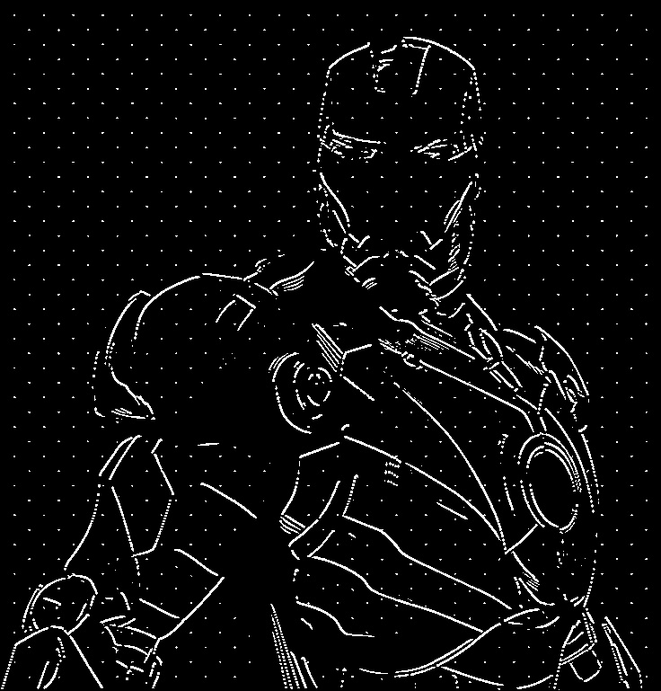
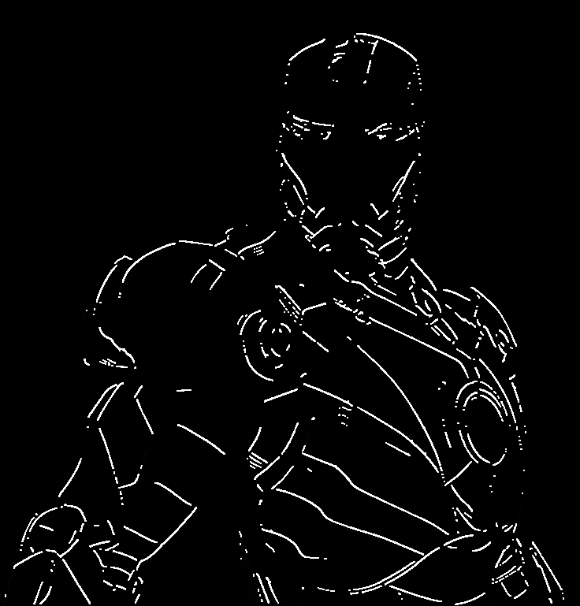
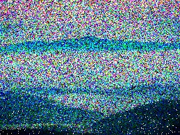
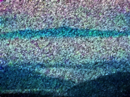

# ARK Selection Tasks: Image Denoising & Medial Axis Detection

**Aerial Robotics Kharagpur (ARK) · Fresher Selection · Tasks 2.2 and 2.3**
by Neal Kauntia


This repository holds my submissions for two computer-vision tasks from the ARK selection round.

- **Task 2.2: Noise filtering.** Restore two heavily corrupted images, a black-and-white line drawing and a colour landscape photo, without destroying the fine detail that makes them recognisable.
- **Task 2.3: Medial axis detection.** Track the centre line of a thin instrument moving through video, using a **Hough line transform written from scratch** (`cv.HoughLines` and `cv.HoughLinesP` are not allowed).

Every task has a short write-up in IEEEtran format (the `.tex` files) covering what I tried, what failed and why I settled on the final pipeline.

## Contents

- [At a glance](#at-a-glance)
- [Repository structure](#repository-structure)
- [Quick start](#quick-start)
- [Task 2.2: Noise filtering](#task-22-noise-filtering)
  - [2.2a Line drawing](#22a-line-drawing-salt-noise)
  - [2.2b Scenery photo](#22b-scenery-photo-dense-multicolour-noise)
- [Task 2.3: Medial axis detection](#task-23-medial-axis-detection)
- [Reports](#reports)
- [References](#references)

## At a glance

| Task | Problem | Final pipeline | Code |
|------|---------|----------------|------|
| **2.2a** | Salt noise on a thin-line drawing | grayscale → median blur 3×3 → opening 2×2 | [`iron_man.py`](Task_2.2/iron_man.py) |
| **2.2b** | Dense multicolour noise on a landscape photo | Gaussian 3×3 → Non-Local Means → opening (ellipse 2×2) | [`scenary.py`](Task_2.2/scenary.py) |
| **2.3** | Medial axis of a moving instrument in video | MOG2 → clean-up → Sobel → **custom Hough** → mean of two parallel peaks | [`task_2_3_1mp4.py`](Task_2.3/task_2_3_1mp4.py) · [`2`](Task_2.3/task_2_3_2mp4.py) · [`3`](Task_2.3/task_2_3_3mp4.py) |

## Repository structure

```text
.
├── README.md
├── Task_2.2/
│   ├── iron_man.py               # line-drawing denoiser
│   ├── iron_man_noisy.jpg        # input
│   ├── iron_man_final.png        # output
│   ├── scenary.py                # scenery denoiser
│   ├── noisy.jpg                 # input
│   ├── scenary_final.png         # output
│   ├── overleaf_iron_man.tex     # report: line drawing
│   └── overleaf_scenery.tex      # report: scenery
└── Task_2.3/
    ├── 1.mp4  2.mp4  3.mp4       # input videos
    ├── task_2_3_1mp4.py          # medial axis on 1.mp4
    ├── task_2_3_2mp4.py          # medial axis on 2.mp4
    ├── task_2_3_3mp4.py          # medial axis on 3.mp4
    └── overleaf_medial_axis.tex  # report: medial axis
```

## Quick start

```bash
git clone <this-repo-url>
cd <this-repo>
pip install opencv-python numpy
```

The scripts load their inputs by relative path, so run each one from inside its own task folder. They open OpenCV windows (`cv.imshow`), so you need a desktop session.

```bash
# Task 2.2: writes iron_man_final.png / scenary_final.png next to the scripts
cd Task_2.2
python iron_man.py
python scenary.py

# Task 2.3: pick the video you want
cd ../Task_2.3
python task_2_3_1mp4.py      # or task_2_3_2mp4.py / task_2_3_3mp4.py
```

- Task 2.2: press any key to close the windows.
- Task 2.3: press **Esc** to quit early. The result is shown live and is not written to disk.

---

## Task 2.2: Noise filtering

Two images, two very different noise problems, so two different pipelines.

### 2.2a Line drawing (salt noise)

The input is a white line drawing on a black background, covered in isolated white pixels.

| Noisy input | Result |
|:-----------:|:------:|
|  |  |

**The difficulty.** Noise and signal are both pure white (255), so thresholding cannot tell them apart. What does differ is context: noise pixels are *isolated*, while line pixels are *connected* into strokes 1 to 3 px wide. Anything that blurs (Gaussian) attacks the strokes just as much as the noise, so the filter has to exploit that structural difference instead.

**Final pipeline** ([`iron_man.py`](Task_2.2/iron_man.py)):

```python
gray    = cv.cvtColor(img, cv.COLOR_BGR2GRAY)
medfil  = cv.medianBlur(gray, 3)                                   # kills isolated salt pixels
kernel  = cv.getStructuringElement(cv.MORPH_RECT, (2, 2))
result  = cv.morphologyEx(medfil, cv.MORPH_OPEN, kernel)           # removes leftover pairs/clusters
```

**Why it works**

- **Median 3×3.** An isolated white pixel in a 3×3 window is outvoted 8 to 1 by its black neighbours, so it disappears. A connected stroke pixel keeps enough white neighbours to survive.
- **Opening 2×2.** Erosion with a 2×2 element deletes anything thinner than 2 px (noise pairs that fooled the median), and dilation restores the strokes that survived.

**What I tried along the way**

| Method | Settings tested | Outcome |
|--------|-----------------|---------|
| Gaussian blur | 3×3 σ=0.5 up to 7×7 σ=1.5 | Either noise survives or strokes smear into blobs. Grey haze destroys the binary look. **Rejected.** |
| Median blur | 3×3 | Sparse dots remain, minimal edge damage (**kept**) |
| | 5×5 | Most dots gone, slight line thinning |
| | 7×7, 9×9 | Gaps in strokes, thin lines break |
| Morphological opening | 2×2 | Removes isolated pixels, minimal damage (**kept**) |
| | 3×3 to 5×5 | Thin lines erode, fragment, then vanish |

Full discussion: [`overleaf_iron_man.tex`](Task_2.2/overleaf_iron_man.tex).

### 2.2b Scenery photo (dense multicolour noise)

The input is a landscape (sky gradient, a teal band, dark hills) with independent salt-and-pepper noise on every RGB channel.

| Noisy input | Result |
|:-----------:|:------:|
|  |  |

**The difficulty.** The noise is so dense that in a small window most pixels are corrupted, so local filters such as a small median return a noisy value. A photo also has smooth gradients that large kernels flatten into bands. Per-channel filtering risks hue shifts too.

**Final pipeline** ([`scenary.py`](Task_2.2/scenary.py)):

```python
gaus   = cv.GaussianBlur(img, (3, 3), 0.5)                       # tame the most extreme pixels
result = cv.fastNlMeansDenoisingColored(gaus, None, h=10, hColor=10,
                                        templateWindowSize=7, searchWindowSize=21)
kernel = cv.getStructuringElement(cv.MORPH_ELLIPSE, (2, 2))
final  = cv.morphologyEx(result, cv.MORPH_OPEN, kernel)          # clean residual bright clusters
```

**Why it works**

- **Non-Local Means** compares patches across a large search window, so it can find clean, similar patches even where every immediate neighbour is noisy. `fastNlMeansDenoisingColored` works in LAB space, which keeps colours consistent.
- **Light Gaussian pre-smoothing** reduces the amplitude of outlier pixels so NLM's patch-similarity scores are more reliable. At 3×3 with σ=0.5 it does this without blurring scene features. A 7×7 kernel was too strong: edges reached NLM already blurred.
- **Opening (ellipse 2×2)** is a final pass for leftover bright specks. The ellipse has no preferred axis, which is the safer default for natural images.

**NLM parameter tuning**

| `h` | `hColor` | template | search | Observation |
|:---:|:--------:|:--------:|:------:|-------------|
| 5 | 5 | 7 | 15 | Insufficient, noise remains |
| **10** | **10** | **7** | **21** | **Best balance (chosen)** |
| 15 | 10 | 7 | 21 | Over-smoothed, sky texture lost |
| 10 | 10 | 5 | 21 | Slightly weaker colour recovery |
| 10 | 10 | 7 | 35 | Marginally better, very slow |
| 20 | 15 | 9 | 21 | Strong removal, gradient goes flat |

Plain median blur (3×3 to 11×11) and plain Gaussian blur were also tried and ruled out. They either left noise behind, banded the sky gradient or lost the horizon. Details in [`overleaf_scenery.tex`](Task_2.2/overleaf_scenery.tex).

---

## Task 2.3: Medial axis detection

**Goal.** In each frame of a video, find the **medial axis** (the centre line, equidistant from both long edges) of a thin surgical instrument and draw it over the frame. The three clips (`1.mp4`, `2.mp4`, `3.mp4`) are 1920×1080 at 30 fps, 15 to 16 s each (463, 472 and 473 frames). In them a thin instrument enters from the top of the frame and moves orange rings between white pegs.

**Constraint.** `cv.HoughLines` and `cv.HoughLinesP` are forbidden, so the `(ρ, θ)` accumulator is built by hand with NumPy.

### Pipeline


| Stage | Operation | Purpose |
|-------|-----------|---------|
| 1 | `createBackgroundSubtractorMOG2(detectShadows=False)` | Isolate the moving instrument as a white foreground mask. Shadow detection is off so no grey regions confuse the edge step. |
| 2 | Median 5×5 → Gaussian 3×3 (σ=0.5) → morphological closing 3×3 | Remove speckle from the mask, smooth it for cleaner gradients and fill small holes in the silhouette. |
| 3 | Sobel in x and y, magnitude `√(sx² + sy²) > 50` | Keep only strong edges, which means fewer pixels to vote and sharper accumulator peaks. |
| 4 | Hand-written Hough transform | Every edge pixel `(x, y)` votes for each θ in `[0°, 180°)` (1° steps) at `ρ = x·cosθ + y·sinθ`. ρ runs over `[−d, d]`, where `d` is the image diagonal, so the accumulator is `(2d+1) × 180`. |
| 5 | Peak picking | Take the strongest cell (edge 1). Scan down the sorted votes for the next cell whose θ is within **5°** of the first (edge 2, roughly parallel). |
| 6 | Medial axis | `ρ_med = (ρ₁+ρ₂)/2`, `θ_med = (θ₁+θ₂)/2`. The line passes through `(ρ_med·cosθ_med, ρ_med·sinθ_med)` with direction `(−sinθ_med, cosθ_med)`. It is drawn ±1000 px in magenta (`(255, 0, 255)`, 2 px). |

The core of the transform ([`task_2_3_1mp4.py`](Task_2.3/task_2_3_1mp4.py)):

```python
rhos   = np.arange(-diag, diag + 1, 1)
thetas = np.deg2rad(np.arange(0, 180))
vote   = np.zeros((len(rhos), len(thetas)), dtype=np.uint64)

non_zero_y, non_zero_x = np.nonzero(binary)
for i in range(len(non_zero_x)):
    x, y = non_zero_x[i], non_zero_y[i]
    for theta_index in range(len(thetas)):
        rho = int(x * np.cos(thetas[theta_index]) + y * np.sin(thetas[theta_index]))
        vote[rho + diag, theta_index] += 1
```

The three scripts are identical except for the input filename (`1.mp4`, `2.mp4`, `3.mp4`).

### Debugging notes

| # | Symptom | Cause | Fix |
|---|---------|-------|-----|
| 1 | Line hugged one side of the tool | Only the single strongest peak was used, and that is one *edge*, not the centre | Find a second, parallel peak and average the two |
| 2 | Line direction was wrong (it appeared perpendicular to the tool) | The θ **index** (0–179) was passed to `np.cos`/`np.sin` as if it were radians | Look up the angle first: `theta = thetas[theta_index]` |

### Running it

```bash
cd Task_2.3
python task_2_3_1mp4.py      # Esc to quit
```

The Hough voting is plain Python loops over every edge pixel × 180 angles. On 1080p frames that took roughly 1 to 3.5 s per frame on a cloud CPU (it varies with how many edge pixels the frame has), so playback is much slower than real time. See [Future work](#future-work).

### Results and limitations

- The axis follows the instrument's orientation and approximate position through the clip. The 5° parallelism check rejects background edges, which sit at very different angles.
- The line is a full-length line, not clipped to the instrument's tip.
- It can flicker when the instrument moves fast and MOG2 produces an incomplete mask.
- Peak picking has no non-maximum suppression, so the "second" peak is sometimes a neighbouring accumulator cell of the first. In those frames the line sits on one edge of the instrument instead of exactly midway.
- MOG2 has no warm-up, so the first few frames give a poor foreground mask.

### Future work

- **Non-maximum suppression** on the accumulator, so the second peak is always a distinct edge.
- **Temporal smoothing:** an exponential moving average on `(ρ, θ)` to stabilise the line between frames.
- **Vectorise the accumulator fill** (same algorithm, NumPy instead of nested loops) for a large speed-up.
- **Probabilistic Hough from scratch:** vote with a random subset of edge pixels per frame.
- **Adaptive edge threshold:** Otsu on the gradient-magnitude histogram instead of a fixed 50.
- **MOG2 warm-up:** learn the background for about 30 frames before processing.
- *(Task 2.2)* **Adaptive median filtering** for varying noise density, and a classical ML model that predicts the best median kernel size for an unseen line drawing.

---

## Reports

Each task has an IEEEtran-style write-up with the problem statement, every attempt (with parameter tables), the final approach and conclusions. Upload the `.tex` file to [Overleaf](https://www.overleaf.com/) (or compile with `pdflatex`) to read it.

| Task | Report |
|------|--------|
| 2.2a Line drawing | [`Task_2.2/overleaf_iron_man.tex`](Task_2.2/overleaf_iron_man.tex) |
| 2.2b Scenery | [`Task_2.2/overleaf_scenery.tex`](Task_2.2/overleaf_scenery.tex) |
| 2.3 Medial axis | [`Task_2.3/overleaf_medial_axis.tex`](Task_2.3/overleaf_medial_axis.tex) |

## References

- Beau Carnes, [OpenCV full course (freeCodeCamp)](https://www.freecodecamp.org/news/opencv-full-course/)
- [OpenCV documentation](https://docs.opencv.org/)
- [NumPy documentation](https://numpy.org/devdocs/)
- [GeeksforGeeks](https://www.geeksforgeeks.org/)
- Adam Lusted (etoxin), [Git commands cheat sheet (gist)](https://gist.github.com/etoxin/1acb257550b1de60fe99)

---

<sub>Neal Kauntia · ARK Fresher Selection</sub>
